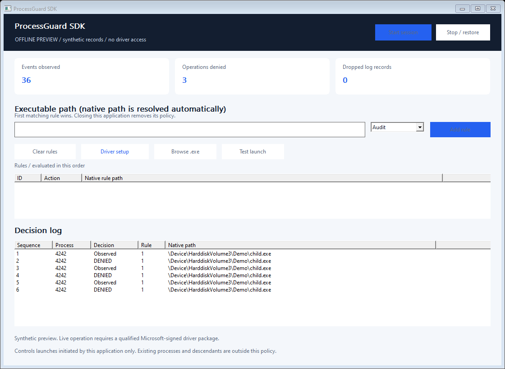

# ProcessGuard SDK - Windows Kernel Process Launch Policy Driver

Observe and deny selected executable launches initiated by your own native application, with a two-file C++ SDK and a readable decision log.

**Engineering preview:** driver signing and production qualification are pending. The public download currently contains the application and SDK; the kernel implementation stays private.



## What it does

- Audit or deny exact executable paths through the documented process-creation callback, before a newly created process runs.
- Scope decisions to the actual process that owns the SDK session, using a referenced process object rather than a reusable PID or nominated parent ID.
- Resolve a selected executable to its native device path; compare paths without case sensitivity.
- Apply rules in the kernel without waiting for UI or a cloud service.
- Automatically remove the policy on owner-handle cleanup, including abrupt client exit.

Use it for controlled launchers, QA harnesses and application-specific policy integration. In the UI, choose an executable, add an Audit rule, start the session and use **Test launch**. A program started by Explorer or another process is outside this session's scope.

This is a scoped process launch component, not a full endpoint protection product. It does not protect existing process memory/handles, terminate or hide processes, block every descendant, or replace Windows App Control/WDAC. Alternate hard links, renamed images, delegated launches, code already running in the client, administrators and kernel code are not blocked as a security boundary. Unknown, noncanonical or overlong image names continue and carry explicit flags. Another process callback can still reject an audited launch afterwards.

## Download and installation

Download the complete Windows x64 ZIP from [Releases](https://github.com/titanfyre/ProcessGuard-SDK/releases). Extract the archive before starting the application.

1. Run **ProcessGuardApp.exe --preview** to explore the interface with explicitly synthetic records. This needs no driver and changes no Windows policy.
2. Live mode requires the separately qualified Microsoft-signed driver package. **Microsoft signing is still pending; test signatures used in an isolated lab are not production signatures.** The preview ZIP deliberately contains no unsigned driver or nonfunctional setup executable.
3. Once a signed package is available, its single-file **ProcessGuardSetup.exe** installs the exact embedded driver. Accept elevation and restart only when setup requests it. **ProcessGuardSetupConsole.exe /install** and **/uninstall** provide the same operations.
4. Open **ProcessGuardApp.exe** as administrator for live operation, add an **Audit** rule, then select **Start session**. Change to **Deny** only after verifying the observed scope. Stop or close the app to remove the policy.

Windows 10 version 2004+ / Windows 11 x64 are the build targets. See [validation and deployment](docs/VALIDATION.md) for the platforms actually exercised. A Microsoft signature alone is not proof of correctness, compatibility or Microsoft endorsement.

## Native C++ integration

Compile `SDK/ProcessGuard.cpp` with your program and include `SDK/ProcessGuard.h`. Use C++17 and link `setupapi.lib`. No runtime service, cloud account or executable scripting engine is needed for policy decisions.

```cpp
#include "ProcessGuard.h"

int main() {
    ProcessGuard::Session policy;
    policy.Start({ProcessGuard::Rule(1, L"C:\\Tools\\child.exe",
        ProcessGuard::Action::Deny)});
    // CreateProcessW(...) called directly here is checked by this policy.
    // Other applications' launches are unaffected.
}
```

The executable must exist so its native path can be resolved. The sample above removes its policy when it returns. `Examples/policy.cpp` performs a direct test launch and prints the real Windows result plus the driver decisions.

| Function | Purpose |
| --- | --- |
| `Session::Start(rules)` | Open the admin-only exclusive interface and atomically install up to 16 rules. |
| `Session::SetRules(rules)` | Replace the complete active rule set; first matching rule wins. |
| `Session::Read()` | Immediately drain at most 16 metadata records. An empty batch means no queued records. |
| `Session::Status()` | Read policy generation, counters, ring occupancy and QPC frequency. |
| `Session::Stop()` / destructor | Close the owner handle and remove its policy. |
| `Rule(id, path, action)` | Build a bounded audit/deny rule. `id` must be unique and nonzero. |

Events include sequence, QPC time, process ID/start key, policy generation, operation, matched rule, decision and a bounded native path. The 256-record ring reports overflow instead of allocating without limit. The UI displays up to 400 records and refreshes every 200 ms; this display cadence does not delay kernel decisions. This is pre-operation policy attribution, not a complete audit of final outcomes or a hardware latency measurement. Calls on one `Session` are serialized; stop all callers before destroying it.

## Build

Install Visual Studio 2022 C++ tools, CMake and a Windows SDK. Run `./Build.ps1` in PowerShell. It builds the native app, console, example, installer sources and offline tests with a static C++ runtime. `./Build.ps1 -Asan` adds user-mode AddressSanitizer checks. Offline checks do not load a driver. Installer source accepts an opaque signed package using `-DriverPackageDirectory`; unsigned or unrelated embedded packages are rejected at runtime.

```text
App/        Native Windows UI and console
SDK/        ProcessGuard.h + ProcessGuard.cpp
Examples/   Small integration example
Installer/  UI/console setup source; kernel implementation excluded
Tests/      Offline protocol validation
docs/       Usage boundaries, validation and commercial integration
```

## Commercial integration

Public application, SDK and installer source are MIT-licensed. The separately delivered kernel implementation is private and is not covered by that source license. This engineering preview does not implement a trial timer, remote activation or an enforceable licensing quota.

For a scoped integration pilot, OEM redistribution rights, deployment qualification or maintenance, contact **`titancsa` on Discord**. See [commercial options](docs/COMMERCIAL.md). Do not deploy the preview as your sole security control.

## Responsible use

Use this software only on systems you own or are authorized to administer. It is intended for legitimate integration, diagnostics and application policy development. You remain responsible for your deployment and compliance with applicable law. The software is provided without warranty under its applicable license; no guarantee of loss prevention, immunity to bypass or liability exclusion beyond applicable law is made.
