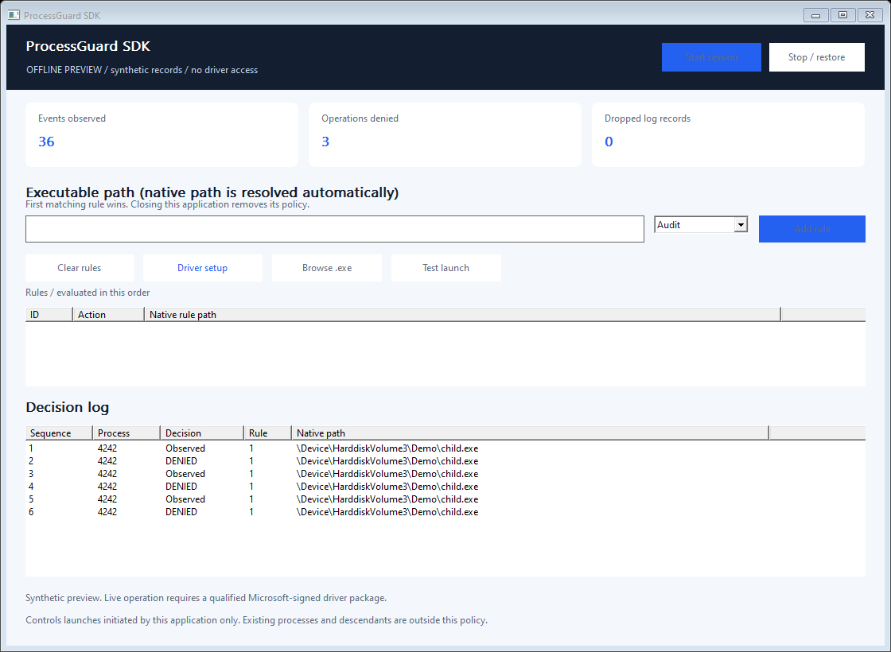

# ProcessGuard SDK - Windows Kernel Process Launch Policy Driver

Observe and deny selected executable launches initiated by your own native application, with a two-file C++ SDK and a readable decision log.

<!-- full-version-contact:start -->
> [!IMPORTANT]
> **Full version and commercial licensing**
>
> **Discord username: `titancsa`**
>
> Open Discord, choose **Friends > Add Friend**, enter **`titancsa`**, then send a direct message. Mention **ProcessGuard SDK** and ask about the **full / production version, commercial use or OEM redistribution**.
>
> Include your intended use and deployment size to discuss pricing, availability and the appropriate licensing / access instructions.
<!-- full-version-contact:end -->

**Microsoft-signed evaluation bundle:** application, two-file SDK, example and self-contained UI/console installers. Evaluation driver source is documented in [driver/README.md](driver/README.md); full/commercial implementation is excluded. See [validation](docs/VALIDATION.md) for the exercised platforms and remaining production qualification.



## What it does

- Audit or deny exact executable paths through the documented process-creation callback, before a newly created process runs.
- Scope decisions to the actual process that owns the SDK session, using a referenced process object rather than a reusable PID or nominated parent ID.
- Resolve a selected executable to its native device path; compare paths without case sensitivity.
- Apply rules in the kernel without waiting for UI or a cloud service.
- Automatically remove the policy on owner-handle cleanup, including abrupt client exit.

Use it for controlled launchers, QA harnesses and application-specific policy integration. In the UI, choose an executable, add an Audit rule, start the session and use **Test launch**. A program started by Explorer or another process is outside this session's scope.

This is a scoped process launch component, not a full endpoint protection product. It does not protect existing process memory/handles, terminate or hide processes, block every descendant, or replace Windows App Control/WDAC. Alternate hard links, renamed images, delegated launches, code already running in the client, administrators and kernel code are not blocked as a security boundary. Unknown, noncanonical or overlong image names continue and carry explicit flags. Another process callback can still reject an audited launch afterwards.

## Download and installation

Download the complete Windows x64 ZIP from [Releases](https://github.com/titanfyre/ProcessGuard-SDK/releases). Extract the archive before starting the application.

1. Run **ProcessGuardApp.exe --preview** to explore the interface with explicitly synthetic records. This needs no driver and changes no Windows policy.
2. Live mode uses the Microsoft-signed evaluation driver embedded in both setup executables. The optional offline tour above requires no driver.
3. Run **ProcessGuardSetup.exe** to install the exact embedded driver. Accept elevation and restart only when setup requests it. **ProcessGuardSetupConsole.exe /install** and **/uninstall** provide the same operations.
4. Open **ProcessGuardApp.exe** as administrator for live operation, add an **Audit** rule, then select **Start session**. Change to **Deny** only after verifying the observed scope. Stop or close the app to remove the policy.

Windows 10 version 2004+ / Windows 11 x64 are the build targets. See [validation and deployment](docs/VALIDATION.md) for the platforms actually exercised. A Microsoft signature alone is not proof of correctness, compatibility or Microsoft endorsement.

## Native C++ integration

Compile `SDK/ProcessGuard.cpp` with your program and include `SDK/ProcessGuard.h`. Use C++17 and link `setupapi.lib`. No runtime service, cloud account or executable scripting engine is needed for policy decisions.

```cpp
#include "ProcessGuard.h"

int main() {
    ProcessGuard::Session policy;
    policy.Start({ProcessGuard::Rule(1, L"C:\\Tools\\child.exe",
        ProcessGuard::Action::Deny)});
    // CreateProcessW(...) called directly here is checked by this policy.
    // Other applications' launches are unaffected.
}
```

The executable must exist so its native path can be resolved. The sample above removes its policy when it returns. `Examples/policy.cpp` performs a direct test launch and prints the real Windows result plus the driver decisions.

| Function | Purpose |
| --- | --- |
| `Session::Start(rules)` | Open the admin-only exclusive interface and atomically install up to 16 rules. |
| `Session::SetRules(rules)` | Replace the complete active rule set; first matching rule wins. |
| `Session::Read()` | Immediately drain at most 16 metadata records. An empty batch means no queued records. |
| `Session::Status()` | Read policy generation, counters, ring occupancy and QPC frequency. |
| `Session::Stop()` / destructor | Close the owner handle and remove its policy. |
| `Rule(id, path, action)` | Build a bounded audit/deny rule. `id` must be unique and nonzero. |

Events include sequence, QPC time, process ID/start key, policy generation, operation, matched rule, decision and a bounded native path. The 256-record ring reports overflow instead of allocating without limit. The UI displays up to 400 records and refreshes every 200 ms; this display cadence does not delay kernel decisions. This is pre-operation policy attribution, not a complete audit of final outcomes or a hardware latency measurement. Calls on one `Session` are serialized; stop all callers before destroying it.

## Build

Demo/evaluation driver source is available; see [driver/README.md](driver/README.md) for
build instructions and separate evaluation-source terms. Those terms apply to
Titan-authored driver code. Third-party source licenses and existing application/SDK
licenses remain applicable. Full/commercial implementation and private signing or
activation material are excluded.

Install Visual Studio 2022 C++ tools, CMake and a Windows SDK. Run `./Build.ps1` in PowerShell. It builds the native app, console, example, installer sources and offline tests with a static C++ runtime. `./Build.ps1 -Asan` adds user-mode AddressSanitizer checks. Offline checks do not load a driver. Installer source accepts an opaque signed package using `-DriverPackageDirectory`; unsigned or unrelated embedded packages are rejected at runtime.

```text
App/        Native Windows UI and console
SDK/        ProcessGuard.h + ProcessGuard.cpp
Examples/   Small integration example
Installer/  UI/console setup source; driver source documented separately in driver/README.md
Tests/      Offline protocol validation
docs/       Usage boundaries, validation and commercial integration
```

## Commercial integration

Public application, SDK and installer source are MIT-licensed. The evaluation driver source has the separate license scope documented in [driver/README.md](driver/README.md); the user-mode source license does not automatically apply to it. The download includes separate `BINARY-LICENSE.txt` evaluation terms. This evaluation build does not implement a trial timer, remote activation or an enforceable licensing quota.

For a scoped integration pilot, OEM redistribution rights, deployment qualification or maintenance, contact **`titancsa` on Discord**. See [commercial options](docs/COMMERCIAL.md). Qualify the component for your deployment; it is not a complete endpoint security control.

## Responsible use

Use this software only on systems you own or are authorized to administer. It is intended for legitimate integration, diagnostics and application policy development. You remain responsible for your deployment and compliance with applicable law. The software is provided without warranty under its applicable license; no guarantee of loss prevention, immunity to bypass or liability exclusion beyond applicable law is made.

<!-- central-sdk-packages:start -->
## SDK : langages et installation

Les sources, licences, guides API et exemples des SDK sont regroupes dans [le depot dedie](https://github.com/TitanCSA/sdk-packages/tree/main/projects/ProcessGuard-SDK). Choisis ton langage ci-dessous, puis execute sa commande dans le dossier de ton application.

| Langage / registre | Disponibilite | Installation / utilisation |
| --- | --- | --- |
| C++ / vcpkg | Registre TitanCSA disponible (configuration ci-dessous) | `vcpkg install processguard-sdk:x64-windows` |
| C++ / Conan | Registre TitanCSA disponible (configuration ci-dessous) | `conan install --requires=processguard-sdk/0.1.2 -r titancsa --build=missing -s compiler.cppstd=17` |
| C++ / NuGet natif | Publie et verifie | `Install-Package ProcessGuard-SDK.Native -Version 0.1.2` |
| C# / .NET | Publie et verifie | `dotnet add package ProcessGuardSDK.SDK --version 1.0.0` |
| Python / pip | Pas encore disponible / validation en cours | Commande prevue apres publication : `python -m pip install processguard-sdk==1.0.0` |
| Python / Conda | Canal TitanCSA disponible ; acceptation conda-forge encore en attente | `conda install --override-channels -c https://raw.githubusercontent.com/TitanCSA/sdk-packages/089bc73095aa8eda89bacbe10d0b9e58394b0207/conda-channel -c conda-forge processguard-sdk` |
| Rust / Cargo | Publie et verifie | `cargo add processguard-sdk@1.0.0` |
| JavaScript et TypeScript / npm | Pas encore disponible / validation en cours | Commande prevue apres publication : `npm install processguard-sdk@1.0.0` |
| Java et Kotlin / Maven Central | Publie et verifie | `io.github.titancsa:processguard-sdk:1.0.0 (pom.xml / Gradle)` |
| Java et Kotlin / JitPack | Publie et verifie | `com.github.titanfyre:ProcessGuard-SDK:java-sdk-v1.0.0 (avec le depot JitPack)` |
| Go / Go Modules | Publie et verifie | `go get github.com/titanfyre/ProcessGuard-SDK/ProcessGuard-SDK-Go-modules@v1.0.0` |
| Go / pkg.go.dev | Publie et verifie | `Documentation : https://pkg.go.dev/github.com/titanfyre/ProcessGuard-SDK/ProcessGuard-SDK-Go-modules@v1.0.0` |
| PowerShell / Gallery | Publie et verifie | `Install-Module ProcessGuardSDK -RequiredVersion 1.0.0 -Scope CurrentUser` |
| Dart et Flutter / pub.dev | Pas encore disponible / validation en cours | Commande prevue apres publication : `dart pub add processguard_sdk:1.0.0` |
| Ruby / RubyGems | Publie et verifie | `gem install processguard-sdk -v 1.0.0` |
| PHP / Composer | Pas encore disponible / validation en cours | Commande prevue apres publication : `composer require titancsa/processguard-sdk:1.0.0` |

Pour vcpkg et Conan, configure d abord le registre TitanCSA avec [ces instructions](https://github.com/TitanCSA/sdk-packages/tree/main/projects/ProcessGuard-SDK/README.md#c-et-c). Pour Java/Kotlin, le guide donne le bloc Maven/Gradle a ajouter. Windows x64 est requis pour les bindings natifs ; les pilotes/applications restent a installer separement.

Les commandes indiquees comme prevues ne sont pas encore disponibles. Les versions Go/JitPack existantes utilisent les anciens tags conserves ; aucun ancien import Go n est renomme.

[Guide complet, prerequis et exemples](https://github.com/TitanCSA/sdk-packages/tree/main/projects/ProcessGuard-SDK/README.md).
<!-- central-sdk-packages:end -->
